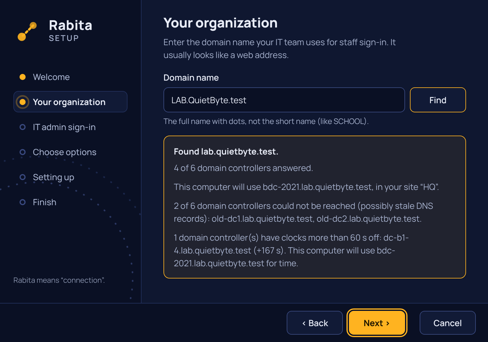

# Rabita

**Join your Linux desktop to your organization's domain — as easily as setting up a Windows PC.**

Rabita (رابطہ — "connection") is a friendly setup wizard for Linux that connects a computer to an Active Directory domain. Once set up:

- **Log in with your work account** at the normal Linux login screen — even offline.
- **Your network drives appear automatically** (H:, S: and the rest), right in your file manager.
- **Your printers are ready** — the ones assigned to you are added at login.

Works with domains on Windows Server 2012 R2 and newer.

## Supported systems
Ubuntu · Debian · Linux Mint · Fedora · Red Hat · Rocky · openSUSE · Arch · Manjaro



## Install

Download `rabita_<version>_amd64.deb` and double-click it, or run
`sudo apt install ./rabita_<version>_amd64.deb`. Then open **Rabita Setup**
from the app menu. (During development the `.deb` is attached to each pull
request's CI run as the **rabita-deb** artifact.)

## Status
🚧 In development. First release (v0.1) coming soon.

Done so far: the **Rabita Setup** wizard (six screens, installs as a `.deb`),
and the root helper behind it, which joins and leaves a domain over D-Bus
with polkit. Network drives and printers come next. See `docs/testing.md`
for how each milestone is tested in the lab.

## How it works
Rabita is a wizard and a small set of background services built on trusted open-source tools — SSSD, realmd, Kerberos, cifs-utils and CUPS. It doesn't replace your login screen; it teaches your system to recognise your organization's accounts. Every change it makes can be undone with **Leave domain**.

## Building from source

Requires a stable Rust toolchain (`rustup`). Milestone 1 has no other dependencies.

```bash
cargo build --workspace
```

```bash
cargo test --workspace
```

Layout: `helper/` (root daemon), `agent/` (per-user service), `app/` (wizard), `backends/` (per-distro logic), `packaging/`, `docs/`. See `docs/architecture.md`.

## License
Apache-2.0 · Made by [QuietByte](https://quietbytehq.github.io)

*Active Directory and Windows are trademarks of Microsoft. Rabita is an independent project, not affiliated with Microsoft.*
